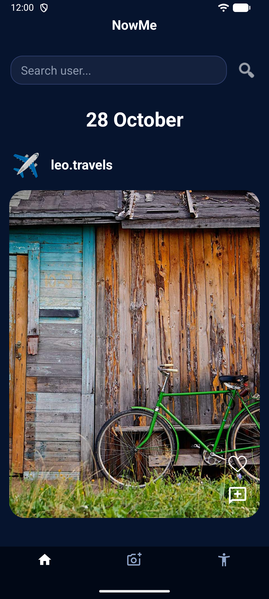
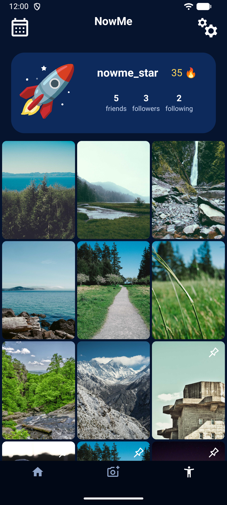
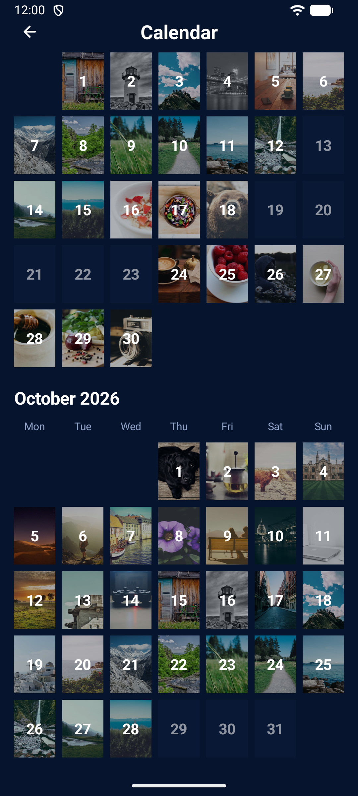

# NowMe Android

[](https://developer.android.com)
[](https://openjdk.org)
[](https://square.github.io/retrofit/)
[](https://github.com/bumptech/glide)
[](https://developer.android.com/jetpack/androidx/releases/security)
[](LICENSE)

**NowMe** is a daily photo-sharing social application inspired by BeReal. It encourages users to capture an authentic snapshot every day, curate a visual chronicle of their life, and share candid moments with their close circle of friends.

This repository contains the native **Android Client**, engineered with modern Android development best practices, secure credential storage, resilient token lifecycle management, and hardware-accelerated image handling.

---

## Project Ecosystem

- [**NowMe Android**](https://github.com/abi4ka/NowMe-Android): The native Android mobile client (this repository).
- [**NowMe Spring**](https://github.com/abi4ka/NowMe-Spring): The companion Spring Boot REST API providing authentication, social graph management, media storage, and OpenAPI documentation.

---

## Screenshots

<div align="center">
  <table>
    <tr>
      <td align="center"><b>Authentication</b></td>
      <td align="center"><b>Main Feed</b></td>
      <td align="center"><b>Camera & Publish</b></td>
    </tr>
    <tr>
      <td></td>
      <td></td>
      <td></td>
    </tr>
    <tr>
      <td align="center"><b>Post Details & Comments</b></td>
      <td align="center"><b>User Profile</b></td>
      <td align="center"><b>Memories Calendar</b></td>
    </tr>
    <tr>
      <td></td>
      <td></td>
      <td></td>
    </tr>
  </table>
</div>

---

## Architectural Highlights

### 1. Jetpack Navigation & Single-Activity Architecture
- `MainActivity` hosts a `NavHostFragment` coordinating navigation between top-level destinations (`HomeFragment`, `CameraFragment`, `ProfileFragment`) and secondary flows.
- State preservation across tab switches powered by dedicated AndroidX `ViewModel` instances (`HomeFeedViewModel`, `ProfileViewModel`).

### 2. Enterprise-Grade Credential Security
- **AndroidX Security Crypto**: `TokenStorage` uses `EncryptedSharedPreferences` backed by the hardware-backed Android Keystore (`MasterKey` with AES256-GCM value encryption and AES256-SIV key encryption).
- **Graceful Fallback**: Transparently handles legacy migration or devices lacking hardware keystore modules.

### 3. Resilient Networking & Token Lifecycle
- **Retrofit 3 & OkHttp**: Thread-safe singleton `RetrofitClient` with custom interceptors and converters.
- **Automatic Token Refresh**: OkHttp `AuthAuthenticator` automatically catches HTTP 401 Unauthorized responses, acquires fresh access tokens using the refresh token, and replays failed requests seamlessly without user interruption.
- **Session Termination**: Full logout support clearing tokens locally and invalidating sessions on the backend.

### 4. Optimized Image Loading Pipeline (Glide)
- **NowmeImageLoader**: Centralized helper providing memory caching, disk caching (`DiskCacheStrategy.ALL`), request cancellation on RecyclerView recycling, and smooth cross-fade transitions.
- **Dynamic JWT Authorization**: Leverages Glide's `LazyHeaders` to dynamically supply valid `Authorization: Bearer <token>` credentials for authenticated image endpoints.

### 5. Camera & Media Processing
- **CameraX**: Hardware camera integration supporting tap-to-focus and front/back lens selection.
- **EXIF Normalization**: `ImageOrientationUtils` handles EXIF orientation flags, ensuring images are stored upright across all device orientations.

### 6. Modern Material 3 UI/UX
- **BottomSheet Dialogs**: Settings panel extracted into a standalone `SettingsBottomSheetDialogFragment`.
- **Empty States & Feedback**: Graceful empty state placeholders for empty feeds, empty profiles, and zero-match user searches.
- **100% English Localization**: Fully consolidated Android string resources in `strings.xml`.

---

## Project Structure

```text
NowMe/app/src/main/
├── java/com/example/nowme/
│   ├── network/            # Retrofit client, API interface, DTOs, AuthInterceptor & Authenticator
│   ├── ui/
│   │   ├── auth/           # Login & Registration activities
│   │   ├── camera/         # CameraX capture & preview fragment
│   │   ├── home/           # Main feed, user search adapter, FeedAdapter
│   │   ├── main/           # MainActivity and primary navigation controller
│   │   ├── nowme/          # Post detail activity, comments sheet helper
│   │   └── profile/        # ProfileFragment, CalendarHistoryActivity, SettingsBottomSheet
│   └── util/               # NowmeImageLoader, state stores, EXIF orientation utilities
└── res-ui/                 # Feature-modularized resource folders
    ├── auth/               # Auth layouts and drawables
    ├── camera/             # Camera preview UI
    ├── home/               # Feed & search layouts
    ├── main/               # Main container & bottom navigation
    ├── nowme/              # Fullscreen post viewer layouts
    └── profile/            # Profile card, grid & bottom sheet layouts
```

---

## Getting Started

### Prerequisites
- **Android Studio** Hedgehog (2023.1.1) or newer.
- **JDK 17** or **JDK 21** configured in Android Studio.
- **Android SDK Platform 34+** installed.
- Running instance of [NowMe Spring](https://github.com/abi4ka/NowMe-Spring).

### Configuration
By default, the app is pre-configured to communicate with the Spring server running locally:

```text
http://10.0.2.2:25565/
```
*(Default alias for `localhost` in the Android Emulator)*.

To run on a physical device over Wi-Fi, change `BASE_URL` in `RetrofitClient.java` to your machine's local IP address (e.g., `http://192.168.1.100:25565/`).

### Building and Testing

Run unit tests via Gradle:
```bash
cd NowMe
./gradlew testDebugUnitTest
```

Assemble debug APK:
```bash
./gradlew assembleDebug
```

---

## Contributing & Authors

- Developed by **Nikita** ([@abi4ka](https://github.com/abi4ka)) and project partner as an advanced academic project.
- Modernized, refactored, and maintained as a showcase portfolio repository.
