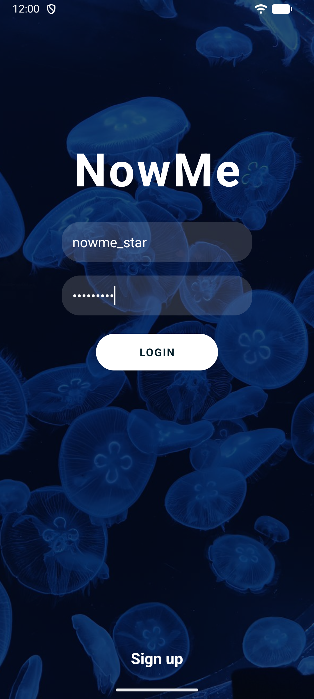
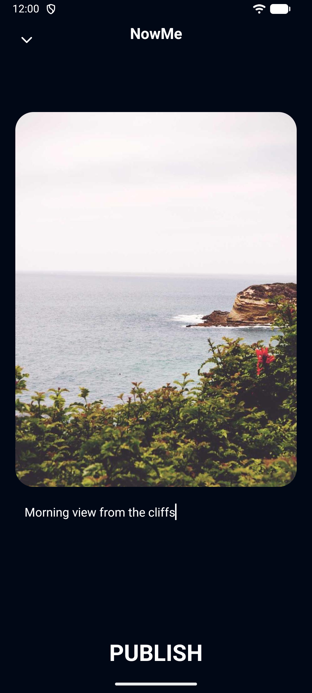
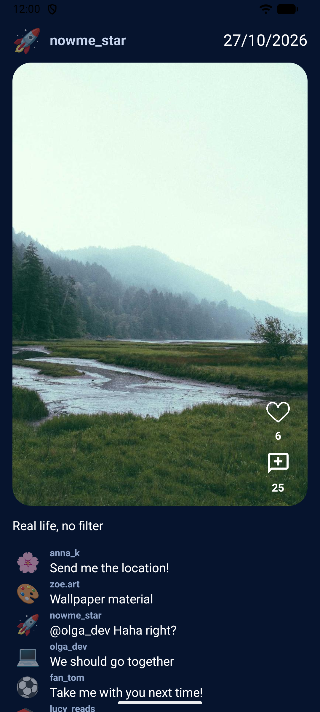

# NowMe Android

[](https://developer.android.com)
[](https://openjdk.org)
[](https://developer.android.com/media/camera/camerax)
[](https://square.github.io/retrofit/)
[](https://square.github.io/okhttp/)
[](https://github.com/bumptech/glide)
[](https://developer.android.com/guide/navigation)
[](https://developer.android.com/jetpack/androidx/releases/security)
[](https://github.com/material-components/material-components-android)

Android client for **NowMe**, a daily photo-sharing app inspired by BeReal: post one photo a day, keep a calendar of your own life and see what your friends are up to.

The app needs the backend from [NowMe-Spring](https://github.com/abi4ka/NowMe-Spring).

<p align="center">
  
  
  
</p>
<p align="center">
  
  
  
</p>

## Features

- Register and sign in. The session stays alive through automatic token refresh.
- Take a photo with the camera or pick one from the gallery, add a description and publish it.
- Photos taken with the camera are also saved to the phone gallery under `Pictures/NowMe`. Your own posts can be saved again from the post menu.
- The feed shows posts from you and the people you follow over the last 7 days. It loads more as you scroll and supports pull-to-refresh.
- Like and comment on posts.
- Search for users, view their profiles, and follow or unfollow them.
- Your profile has an emoji avatar, pinned posts and a calendar of every past post.
- Each post can be public or friends-only. Posts can also be pinned or deleted.

## Getting Started

You need a recent Android Studio (AGP 8.13, JDK 17+) and a running [NowMe-Spring](https://github.com/abi4ka/NowMe-Spring) server. Demo accounts are listed in its README, for example `nowme_star` / `Star2026!`.

The server address is compiled in as `BuildConfig.BASE_URL`:

| Build | Default | Override in `NowMe/local.properties` |
|---|---|---|
| debug | `http://10.0.2.2:25565/` (your computer, as seen from the emulator) | `nowme.baseUrl` |
| release | none, must be set | `nowme.releaseBaseUrl` (HTTPS only) |

To use a real phone, connect it to the same Wi-Fi as your computer. Then set your computer's LAN IP and rebuild:

```properties
nowme.baseUrl=http://192.168.1.100:25565/
```

Plain HTTP is allowed in debug builds only.

## Build and Test

```bash
cd NowMe
./gradlew assembleDebug
./gradlew testDebugUnitTest
```

## Project Layout

```text
NowMe/app/src/main/
  java/com/example/nowme/
    network/     Retrofit API, DTOs, token storage, auth interceptor and token refresh
    ui/auth/     sign in and registration
    ui/camera/   CameraX capture and publish screen
    ui/home/     feed and user search
    ui/nowme/    post screen, comments
    ui/profile/  profile, calendar, history, settings
    ui/main/     MainActivity with bottom navigation
    util/        image loading, gallery saving, background executors, shared UI state
  res-ui/        layouts and drawables grouped by screen
```
